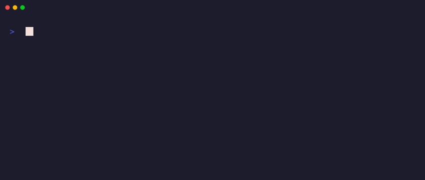

# Expose – Pure Go Localhost Tunneling CLI



[](https://github.com/kernelshard/expose/releases)
[](https://kernelshard.github.io/expose/)
[](https://github.com/kernelshard/expose/actions/workflows/test.yml)
[](https://codecov.io/gh/kernelshard/expose)
[](https://github.com/kernelshard/expose/blob/main/LICENSE)
[](https://alternativeto.net/software/kernelshard-expose/about/?utm_source=badge&utm_medium=referral)

> **The drop-in, open-source Go alternative to ngrok.**  
> Start instantly on free public relays with zero config and zero signups, or graduate to your own self-hosted relay on a $5 VPS in a single <10MB binary. Zero lock-in.

**Install via Homebrew:**
```bash
brew install kernelshard/tap/expose
```

**Tunnel your local server (e.g. port 3000):**
```bash
expose tunnel 3000
```

---

## 💡 What is this for?

When you run an app on `http://localhost:3000`, only your laptop can access it. **Expose creates a temporary public HTTPS URL that connects directly to your local server:**

- 🪝 **Webhook Testing:** Give Stripe, GitHub, or Twilio a live HTTPS URL to test webhook callbacks locally.
- 📱 **Mobile & Device Testing:** Open your local website on a physical smartphone or tablet over 4G/5G.
- 👥 **Instant Previews:** Send a live demo link to a friend or client without deploying to cloud servers.
- 🏠 **Private Self-Hosting:** Route traffic through your own private VPS instead of commercial SaaS relays.

---

## 🆚 Why Expose?

| Feature | 🚀 **Expose** | ngrok | Cloudflare Tunnel | LocalTunnel (Node) |
| :--- | :---: | :---: | :---: | :---: |
| **Zero Signup Required** | ✅ Instant | ❌ Mandatory account | ❌ Mandatory account | ✅ Instant |
| **Single Static Binary** | ✅ (<10MB) | ✅ (~30MB) | ✅ (~50MB) | ❌ (requires Node.js) |
| **Open Source** | ✅ Apache 2.0 | ❌ Proprietary | ✅ Apache 2.0 | ✅ MIT |
| **Self-Hostable Relay** | ✅ `expose server` | ❌ SaaS only | ❌ Cloudflare network | ⚠️ Legacy Node server |
| **Language & Runtime** | Pure Go (zero CGO) | Go / C | Go daemon | Node.js (V8 heap) |
| **Free Custom Domains** | 🟡 Partial (Self-Hosted) | 💲 Paid plan | ✅ Cloudflare DNS | ❌ Not supported |
| **Memorable Subdomains** | ✅ Auto-assigned (`swift-falcon-4821`) | ❌ Random hex (free tier) | ❌ Random hex | ⚠️ Limited words |

---

## ⚡ Quickstart

### Option A: Instant Public Tunnel (Zero Setup)
Expose your local development server in seconds without creating an account:

```bash
# Public relay (default)
expose tunnel 3000

# Or via Cloudflare Quick Tunnels
expose tunnel 3000 --provider=cloudflare
```

### Option B: Sovereign Mode (Self-Hosted on Your VPS)
Want permanent custom subdomains, full privacy, and zero rate limits? Run your private relay on any $5 VPS:

```bash
# 1. On your VPS (Turnkey Docker + Caddy Auto-TLS)
git clone https://github.com/kernelshard/expose.git && cd expose/deploy
cp .env.example .env && docker compose up -d

# 2. On your laptop
expose tunnel 3000 --server=tunnel.yourdomain.com:7890 --subdomain=api
```

---

## 📦 Installation Options

### 1. Homebrew (macOS & Linux — Recommended)

```bash
brew install kernelshard/tap/expose
```

### 2. One-Line Shell Installer

```bash
curl -fsSL https://raw.githubusercontent.com/kernelshard/expose/main/install.sh | sh
```

Pin a specific version or install to a custom path:
```bash
# Pin version
VERSION=v0.6.3 curl -fsSL https://raw.githubusercontent.com/kernelshard/expose/main/install.sh | sh

# Custom directory
BINDIR=~/.local/bin curl -fsSL https://raw.githubusercontent.com/kernelshard/expose/main/install.sh | sh
```

### 3. Pre-built Binaries
Download the latest pre-compiled binary for your architecture (macOS, Linux, Windows) from the [Releases Page](https://github.com/kernelshard/expose/releases).

### 4. Via Go Install (Go 1.22+)

```bash
go install github.com/kernelshard/expose/cmd/expose@latest
```

### 5. From Source

```bash
git clone https://github.com/kernelshard/expose.git
cd expose
go build -o expose ./cmd/expose
./expose --version
```

### 📖 Man Page

Expose provides a complete `expose(1)` manual page.

* **Preview locally:**
  ```bash
  man ./man/expose.1
  ```
* **Install system-wide (macOS / Linux):**
  ```bash
  sudo install -d /usr/local/share/man/man1
  sudo install -m 0644 man/expose.1 /usr/local/share/man/man1/expose.1
  man expose
  ```

---

## 🏠 Self-Hosted Relay Server

Need complete privacy, permanent custom subdomains, and zero third-party relay dependence? Run your own private tunnel gateway on any $5 VPS (DigitalOcean, Hetzner, AWS Lightsail).

### Option 1: Turnkey Docker Compose + Caddy Auto-TLS (Recommended)
The fastest path to production with automated TLS termination and edge reverse-proxying:

```bash
git clone https://github.com/kernelshard/expose.git
cd expose/deploy
cp .env.example .env
# Set DOMAIN=tunnel.yourdomain.com in .env
docker compose up -d
```
See [deploy/README.md](deploy/README.md) for DNS setup and configuration options.

### Option 2: Standalone Binary
Run the native compiled binary directly on bare metal:

```bash
# Start your private relay server (open by default)
expose server --domain=tunnel.mysite.com --control-port=7890 --public-port=8080

# Or protect with an auth token (recommended for public VPS)
expose server --domain=tunnel.mysite.com --token=mysecret
```

### Connect From Your Laptop
```bash
# Standard connection
expose tunnel 3000 --server=tunnel.mysite.com:7890 --subdomain=my-app

# If your server requires an auth token
expose tunnel 3000 --server=tunnel.mysite.com:7890 --token=mysecret
```

---

## ⚙️ Project Configuration (`.expose.yml`)

Save defaults per project so you can just type `expose tunnel`:

```bash
# Create .expose.yml in current directory
$ expose init
✓ Config created: .expose.yml
```

```yaml
project: expose
port: 3000
```

Manage and query configuration values:
```bash
expose config list
expose config get port
```

---

## 🏗 Architecture & Systems Design

```text
expose/
├── cmd/expose/       # CLI entry point (Cobra)
├── internal/
│   ├── cli/          # Cobra subcommands & flag parsing
│   ├── config/       # YAML config management
│   ├── pool/         # sync.Pool 32KB buffer recycling (0 allocs/op)
│   ├── provider/     # Tunnel backends (LocalTunnel, Cloudflare, Self-Hosted)
│   ├── server/       # Self-hosted relay control plane & TCP proxy
│   ├── tunnel/       # Core service orchestration & connection lifecycle
│   └── version/      # Build metadata & version injection
└── .expose.yml       # Local project configuration
```

### Data Plane & Socket Topology

```text
[ Public Visitor ]
       │ 1. Connects to https://demo.tunnel.com
       ▼
[ Expose Relay Server (VPS) ]
  ├── 2. Fast L7 Peek: Read initial bytes to extract `Host:` header
  └── 3. Drop to Layer 4: Spliced directly to standby client data socket
       │
       │ (Bidirectional raw TCP stream via sync.Pool 32KB buffers)
       ▼
[ Expose Client (Laptop) ]
  └── 4. Forward raw byte stream to http://localhost:3000
```

### Key Systems Design Principles

- **Layer 4 Raw Socket Splicing:** Rather than incurring full HTTP/2 or JSON parsing overhead on every packet, Expose inspects only the initial bytes to extract the `Host:` header for subdomain routing. Once matched, it immediately drops down to raw bidirectional Layer 4 TCP streaming (`io.CopyBuffer`).
- **Zero-Allocation Buffer Recycling (`sync.Pool`):** Recycles 32KB copy buffers using slice pointers (`*[]byte`) to eliminate Go interface boxing allocations on the heap.
- **Bounded Concurrency Brakes:** The relay server advertises connection limits (`MaxConnections`) during handshake; the client bounds worker goroutines and runs proxy forwarding synchronously to prevent 100% CPU dial spin-loops.
- **Graceful Socket Teardown:** Coordinates bidirectional stream termination, guaranteeing both reader and writer sockets close cleanly on `io.EOF` without leaking goroutines or file descriptors.
- **Modular Provider Abstraction:** Decoupled `Provider` interface cleanly isolates CLI and service lifecycles from underlying network transports (LocalTunnel, Cloudflare, and Self-Hosted relays).

### Performance Benchmarks (`sync.Pool` vs. Naive Buffers)

Bidirectional network proxying performance on the self-hosted relay gateway:

| Implementation | Memory Allocations | Heap Churn (B/op) | Throughput Delta |
| :--- | :---: | :---: | :---: |
| **Standard Unpooled Buffers** | High GC Pressure | ~34,209 B/op | Baseline |
| **Expose 32KB `sync.Pool`** | **0 allocs during stream** | **1,444 B/op (-95.8%)** | **+26% Throughput** |

*Reproduce benchmark locally:*
```bash
go test -bench=BenchmarkCopy ./internal/pool -benchmem
```

---

## 🧪 Development & Testing

```bash
# Run all unit tests with Go race detector
go test ./... -v -race -cover

# Package-specific coverage
go test ./internal/tunnel -cover
go test ./internal/server -cover
go test ./internal/provider -cover
```

---

## 🤝 Contributing

Contributions are welcome! Please check out [CONTRIBUTING.md](CONTRIBUTING.md) for branch strategy, test requirements, and code style guidelines.

---

## 📝 License

Distributed under the **Apache License 2.0**. See [LICENSE](LICENSE) for details.

---

**Made with ❤️ by [@kernelshard](https://github.com/kernelshard)**
