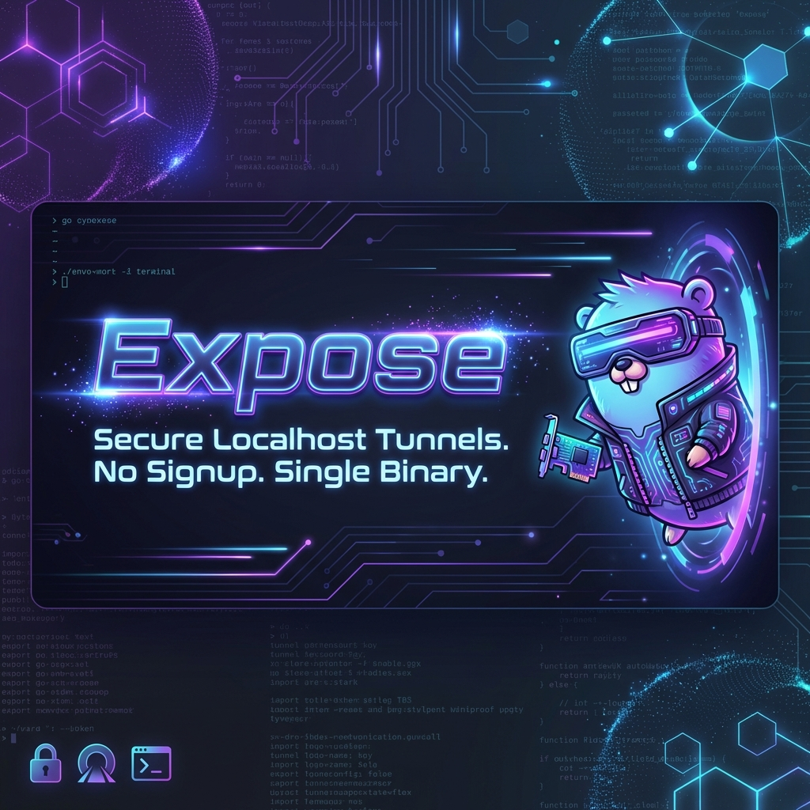

# Expose – Pure Go Localhost Tunneling CLI



[](https://github.com/kernelshard/expose/releases)
[](https://kernelshard.github.io/expose/)
[](https://github.com/kernelshard/expose/actions/workflows/test.yml)
[](https://goreportcard.com/report/github.com/kernelshard/expose)
[](https://github.com/kernelshard/expose/blob/main/LICENSE)

> **Turn your `localhost` into a public shareable URL in one command — zero config, zero signups, and a single <10MB binary.**  
> The lightweight, open-source Go alternative to ngrok for webhook testing, mobile previews, and remote debugging.

**Install via Homebrew:**
```bash
brew install kernelshard/tap/expose
```

**Tunnel your local server (e.g. port 3000):**
```bash
expose tunnel 3000
```

---

## 💡 What is this for?

When you run an app on `http://localhost:3000`, only your laptop can access it. **Expose creates a temporary public HTTPS URL that connects directly to your local server:**

- 🪝 **Webhook Testing:** Give Stripe, GitHub, or Twilio a live HTTPS URL to test webhook callbacks locally.
- 📱 **Mobile & Device Testing:** Open your local website on a physical smartphone or tablet over 4G/5G.
- 👥 **Instant Previews:** Send a live demo link to a friend or client without deploying to cloud servers.
- 🏠 **Private Self-Hosting:** Route traffic through your own private VPS instead of commercial SaaS relays.

---

## 🆚 Why Expose?

| Feature | 🚀 **Expose** | ngrok | Cloudflare Tunnel | LocalTunnel (Node) |
| :--- | :---: | :---: | :---: | :---: |
| **Zero Signup Required** | ✅ Instant | ❌ Mandatory account | ❌ Mandatory account | ✅ Instant |
| **Single Static Binary** | ✅ (<10MB) | ✅ (~30MB) | ✅ (~50MB) | ❌ (requires Node.js) |
| **Open Source** | ✅ Apache 2.0 | ❌ Proprietary | ✅ Apache 2.0 | ✅ MIT |
| **Self-Hostable Relay** | ✅ `expose server` | ❌ SaaS only | ❌ Cloudflare network | ⚠️ Legacy Node server |
| **Language & Runtime** | Pure Go (zero CGO) | Go / C | Go daemon | Node.js (V8 heap) |
| **Free Custom Domains** | 🚧 Planned (#62) | 💲 Paid plan | ✅ Cloudflare DNS | ❌ Not supported |

---

## ⚡ Quick Examples

```bash
# Tunnel a local development server (defaults to port 3000)
expose tunnel 3000

# Tunnel via Cloudflare Quick Tunnels
expose tunnel -P cloudflare -p 8080

# Connect to your private self-hosted relay gateway
expose tunnel 3000 --server=tunnel.mysite.com:7890
```

---

## 📦 Installation Options

### 1. Homebrew (macOS & Linux — Recommended)

```bash
brew install kernelshard/tap/expose
```

### 2. One-Line Shell Installer

```bash
curl -fsSL https://raw.githubusercontent.com/kernelshard/expose/main/install.sh | sh
```

Pin a specific version or install to a custom path:
```bash
# Pin version
VERSION=v0.5.0 curl -fsSL https://raw.githubusercontent.com/kernelshard/expose/main/install.sh | sh

# Custom directory
BINDIR=~/.local/bin curl -fsSL https://raw.githubusercontent.com/kernelshard/expose/main/install.sh | sh
```

### 3. Pre-built Binaries
Download the latest pre-compiled binary for your architecture (macOS, Linux, Windows) from the [Releases Page](https://github.com/kernelshard/expose/releases).

### 4. Via Go Install (Go 1.22+)

```bash
go install github.com/kernelshard/expose/cmd/expose@latest
```

### 5. From Source

```bash
git clone https://github.com/kernelshard/expose.git
cd expose
go build -o expose ./cmd/expose
./expose --version
```

---

## 🏠 Self-Hosted Relay Server

Need complete privacy and zero third-party relay dependence? Run your own tunnel gateway on any $5 VPS with a single command:

```bash
# Start your private relay server
expose server --domain=tunnel.mysite.com --control-port=7890 --public-port=8080
```

Connect your client to your VPS:
```bash
expose tunnel 3000 --server=tunnel.mysite.com:7890
```

---

## ⚙️ Project Configuration (`.expose.yml`)

Save defaults per project so you can just type `expose tunnel`:

```bash
# Create .expose.yml in current directory
$ expose init
✓ Config created: .expose.yml
```

```yaml
project: expose
port: 3000
```

Manage and query configuration values:
```bash
expose config list
expose config get port
```

---

## 🏗 Architecture & Design Principles

```text
expose/
├── cmd/expose/       # CLI entry point (Cobra)
├── internal/
│   ├── cli/          # Cobra subcommands & flag parsing
│   ├── config/       # YAML config management
│   ├── provider/     # Tunnel providers (LocalTunnel, Cloudflare, Self-Hosted)
│   ├── server/       # Self-hosted relay control & public server
│   ├── tunnel/       # Core service orchestration & lifecycle
│   └── version/      # Build metadata & version injection
└── .expose.yml       # Local project configuration
```

- **Interface-Driven:** Extensible `Provider` interface makes adding new tunnel backends straightforward.
- **Clean Separation:** CLI → Service → Provider (strict unidirectionality, zero circular dependencies).
- **Fully Testable:** High test coverage (>80%) across packages with race detector validation (`go test -race`).

---

## 🧪 Development & Testing

```bash
# Run all unit tests with Go race detector
go test ./... -v -race -cover

# Package-specific coverage
go test ./internal/tunnel -cover
go test ./internal/server -cover
go test ./internal/provider -cover
```

---

## 🤝 Contributing

Contributions are welcome! Please check out [CONTRIBUTING.md](CONTRIBUTING.md) for branch strategy, test requirements, and code style guidelines.

---

## 📝 License

Distributed under the **Apache License 2.0**. See [LICENSE](LICENSE) for details.

---

**Made with ❤️ by [@kernelshard](https://github.com/kernelshard)**
